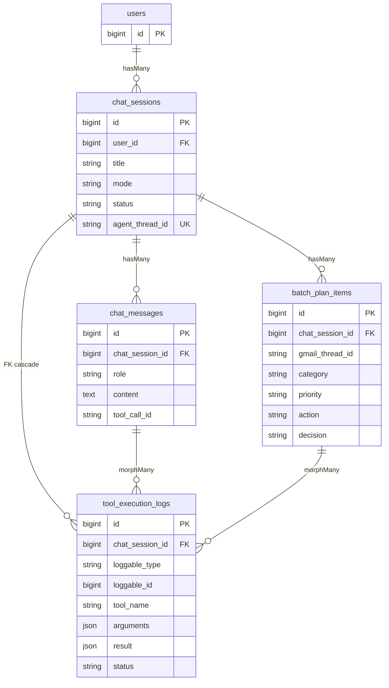

# Gmail Inbox Manager

Aplikasi Laravel untuk mengelola inbox Gmail dengan bantuan agen AI. Laravel
memegang login, UI, database, riwayat, dan log; agen Python (redaksi PII, LLM
kampus, workflow LangGraph, tool Gmail) berada di folder `gmail-agent/`.

## Struktur repo

```
/               proyek Laravel (app/, routes/, database/, resources/, tests/, ...)
gmail-agent/    agen Python: app/, eval/, tests/, requirements.txt
docs/           ERD dan screenshot
```

Folder `app/` di root adalah kode Laravel (namespace `App\`). Kode Python ada di
`gmail-agent/app/`; panduan menjalankannya ada di
[`gmail-agent/README.md`](./gmail-agent/README.md).

## Menjalankan aplikasi

Prasyarat: PHP **8.3 atau lebih baru**, Composer 2, Node.js/npm, dan ekstensi
PHP yang dibutuhkan Laravel (termasuk `pdo_sqlite` bila memakai SQLite).
Semua perintah dijalankan dari root repo.

```powershell
composer install
Copy-Item .env.example .env
php artisan key:generate
New-Item -ItemType File -Path database\database.sqlite -Force
php artisan migrate:fresh --seed
npm install
npm run build
php artisan test
vendor\bin\pint --preset psr12 --test
```

Pastikan `DB_CONNECTION=sqlite` di `.env`. Untuk menjalankan server lokal:

```powershell
php artisan serve
```

Akun seeder: `demo@inbox-manager.test` / `password`.

## Skema dan relasi



`ToolExecutionLog` memakai polymorphic `morphTo()` untuk sumber log dari
`ChatMessage` atau `BatchPlanItem`. Karena pasangan kolom polymorphic tidak
dapat memiliki foreign key, `chat_session_id` tetap menjadi foreign key dengan
cascade; event `deleting` pada kedua sumber menghapus log saat sumber dihapus
secara individual. Alias morph yang dipakai adalah `chat_message` dan
`batch_plan_item`.

`chat_messages.content` hanya menyimpan teks yang sudah diredaksi (contoh:
`<PERSON_1>` dan `<EMAIL_1>`); pemetaan PII tidak disimpan.

## Eager loading dan bukti

Halaman riwayat menggunakan `withCount(['messages', 'toolLogs'])`. Detail sesi
memuat `messages.toolLogs` dan `planItems.toolLogs` melalui eager loading, dan
`Model::preventLazyLoading()` mengungkap relasi yang lupa dimuat saat
development/testing.

Untuk bukti, login dengan akun demo lalu buka detail sesi batch yang berisi 10
item. Buka panel Debugbar bagian **Queries** dan ambil screenshot yang
memperlihatkan halaman batch serta query eager loading untuk sesi, pesan, log
pesan, item batch, dan log item (5 query data agen; query auth/session tidak
dihitung). Screenshot tersimpan di `docs/debugbar-n1.png`.

## Pemetaan keluaran agen Python

| Keluaran agen | Penyimpanan Laravel |
|---|---|
| Perintah pengguna dan jawaban agen (loop ReAct) | `chat_messages` |
| Tool call `id`, `name`, dan `arguments` | `tool_execution_logs` |
| Rencana batch: thread, kategori, prioritas, aksi, draft, alasan | `batch_plan_items` |
| Keputusan review setujui/edit/tolak | `batch_plan_items.decision` |
| Checkpoint LangGraph `thread_id` | `chat_sessions.agent_thread_id` |

Tabel Laravel adalah kontrak data saja; integrasi runtime dengan agen Python
belum termasuk tugas ini.

## API Contract (P11)

Endpoint chat LLM yang dilindungi Sanctum. Laravel memanggil gateway
OpenAI-compatible sesuai urutan `LLM_PROVIDERS` (default Senopati AI ITS, lalu
Ollama lokal sebagai cadangan); provider yang gagal dilewati.

### Konfigurasi `.env`

```dotenv
LLM_PROVIDERS=senopati,ollama
LLM_SENOPATI_URL=          # base URL OpenAI-compatible, contoh https://<host>/v1
LLM_SENOPATI_MODEL=
LLM_SENOPATI_KEY=          # jangan di-commit
LLM_OLLAMA_URL=http://127.0.0.1:11434/v1
LLM_OLLAMA_MODEL=qwen3:4b
LLM_TIMEOUT=60
LLM_MAX_TOKENS=512
```

Ollama opsional: bila tidak berjalan, permintaan langsung diteruskan ke provider
berikutnya.

### Membuat token

```powershell
php artisan app:api-token demo@inbox-manager.test
php artisan app:api-token demo@inbox-manager.test --name=postman
```

Token plain-text hanya ditampilkan sekali.

### Request

| | |
|---|---|
| URL | `POST /api/chat-ai` |
| Header | `Authorization: Bearer <token>`, `Accept: application/json`, `Content-Type: application/json` |
| Rate limit | 10 request per menit per user |

| Field | Aturan | Keterangan |
|---|---|---|
| `prompt` | wajib, string, maks 1000 karakter | pertanyaan pengguna |
| `session_id` | opsional, integer | lanjutkan sesi milik sendiri; kosong = sesi baru |

```json
{ "prompt": "Ringkas email dari dosen tentang Tugas 3.", "session_id": null }
```

Bila `session_id` diisi, 10 pesan terakhir sesi itu ikut dikirim ke LLM sebagai
konteks.

### Respons 200

```json
{
  "status": "success",
  "data": {
    "session_id": 12,
    "model_used": "qwen3-coder",
    "prompt": "Ringkas email dari dosen tentang Tugas 3.",
    "ai_response": "Dosen memberi tahu bahwa batas Tugas 3 diundur ke Jumat 23.59.",
    "timestamp": "2026-11-16T10:15:30+07:00"
  }
}
```

### Kode error

| Status | Kapan | Contoh body |
|---|---|---|
| 401 | Token tidak ada/tidak valid | `{"message": "Unauthenticated."}` |
| 422 | Validasi gagal | `{"message": "Prompt wajib diisi.", "errors": {"prompt": ["Prompt wajib diisi."]}}` |
| 404 | `session_id` tidak ada atau milik user lain | `{"message": "No query results for model [App\\Models\\ChatSession] 999"}` |
| 429 | Lebih dari 10 request/menit (header `Retry-After`) | `{"message": "Too Many Attempts."}` |
| 503 | Semua provider LLM gagal; tidak ada pesan yang disimpan | `{"status": "error", "message": "Layanan LLM sedang tidak tersedia."}` |

### Streaming (challenge): `POST /api/chat-ai/stream`

Header, body, rate limit, dan validasi sama dengan `/api/chat-ai`. Jawaban
dikirim bertahap sebagai Server-Sent Events (`Content-Type: text/event-stream`):

```text
event: delta
data: {"content":"1. Merangkum"}

event: delta
data: {"content":" isi email"}

event: done
data: {"status":"success","data":{"session_id":7,"model_used":"qwen3:14b","prompt":"...","ai_response":"1. Merangkum isi email ...","timestamp":"2026-11-16T06:43:38+07:00"}}
```

- `delta`: potongan jawaban; gabungkan `content` sesuai urutan.
- `done`: dikirim sekali di akhir, isinya sama dengan respons 200 `/api/chat-ai`.
  Pesan baru disimpan ke database pada saat ini.
- `error`: `{"status":"error","message":"Layanan LLM terputus saat menjawab."}`
  bila stream putus di tengah; tidak ada pesan yang disimpan.

Error sebelum stream dimulai (401, 422, 404, 429, 503) tetap dikirim sebagai
JSON biasa dengan bentuk seperti tabel di atas. Fallback provider hanya terjadi
sebelum token pertama dikirim.

Contoh dengan curl (`-N` mematikan buffering):

```powershell
curl.exe -N -X POST http://127.0.0.1:8000/api/chat-ai/stream `
  -H "Authorization: Bearer <token>" -H "Accept: application/json" `
  -H "Content-Type: application/json" --data-binary "@body.json"
```

### Log di database

Setiap request sukses membuat (atau memakai) satu `chat_sessions` milik user dan
menyimpan dua `chat_messages`: pesan `user` dan pesan `assistant` beserta
`model`, `prompt_tokens`, `completion_tokens`, dan `latency_ms`. Kedua pesan
disimpan dalam satu transaksi setelah LLM berhasil.

Catatan: prompt dari endpoint ini disimpan apa adanya (belum diredaksi); redaksi
PII baru ada di agen Python.

Koleksi Postman: [`docs/postman/chat-ai.postman_collection.json`](./docs/postman/chat-ai.postman_collection.json)
(isi variabel `base_url` dan `token`).

## Anggota kelompok

| Nama | NRP |
|---|---|
| Ja'far Balyan Al Karim | 5025241040 |
| Hanif Aqil Janardana | 5025241111 |
| Dafa Kumara Sahasika | 5025241112 |
| Royan Habibi Alfatih | 5025241115 |