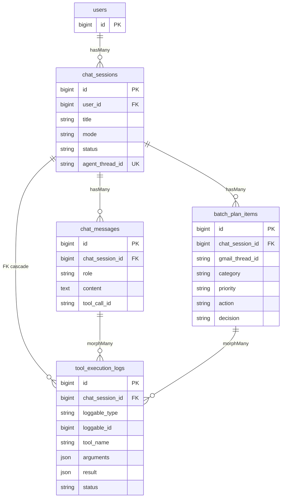

# Gmail Inbox Manager — Laravel Tugas 9

Lapisan data Laravel untuk menyimpan sesi dan pesan agen Gmail, rencana batch,
serta catatan eksekusi tool. Aplikasi Python dan Laravel tetap terpisah karena
keduanya menggunakan direktori `app/` dengan fungsi dan bahasa berbeda.

## Menjalankan aplikasi

Prasyarat: PHP **8.3 atau lebih baru**, Composer 2, Node.js/npm, dan ekstensi
PHP yang dibutuhkan Laravel (termasuk `pdo_sqlite` bila memakai SQLite).

```powershell
cd "F:\SMT5\PBKK\AgenticAI\gmail-inbox-manager\laravel"
composer install
Copy-Item .env.example .env
php artisan key:generate
New-Item -ItemType File -Path database\database.sqlite -Force
php artisan migrate:fresh --seed
npm install
npm run build
php artisan test
vendor\bin\pint --preset psr12 --test
```

Pastikan `DB_CONNECTION=sqlite` di `.env`. Untuk menjalankan server lokal:

```powershell
php artisan serve
```

Akun seeder: `demo@inbox-manager.test` / `password`.

## Skema dan relasi



`ToolExecutionLog` memakai polymorphic `morphTo()` untuk sumber log dari
`ChatMessage` atau `BatchPlanItem`. Karena pasangan kolom polymorphic tidak
dapat memiliki foreign key, `chat_session_id` tetap menjadi foreign key dengan
cascade; event `deleting` pada kedua sumber menghapus log saat sumber dihapus
secara individual. Alias morph yang dipakai adalah `chat_message` dan
`batch_plan_item`.

`chat_messages.content` hanya menyimpan teks yang sudah diredaksi (contoh:
`<PERSON_1>` dan `<EMAIL_1>`); pemetaan PII tidak disimpan.

## Eager loading dan bukti

Halaman riwayat menggunakan `withCount(['messages', 'toolLogs'])`. Detail sesi
memuat `messages.toolLogs` dan `planItems.toolLogs` melalui eager loading, dan
`Model::preventLazyLoading()` mengungkap relasi yang lupa dimuat saat
development/testing.

Untuk bukti, login dengan akun demo lalu buka detail sesi batch yang berisi 10
item. Buka panel Debugbar bagian **Queries** dan ambil screenshot yang
memperlihatkan halaman batch serta query eager loading untuk sesi, pesan, log
pesan, item batch, dan log item (5 query data agen; query auth/session tidak
dihitung). Simpan screenshot sebagai `docs/debugbar-n1.png`.

## Pemetaan keluaran agen Python

| Keluaran agen | Penyimpanan Laravel |
|---|---|
| Perintah pengguna dan jawaban agen (loop ReAct) | `chat_messages` |
| Tool call `id`, `name`, dan `arguments` | `tool_execution_logs` |
| Rencana batch: thread, kategori, prioritas, aksi, draft, alasan | `batch_plan_items` |
| Keputusan review setujui/edit/tolak | `batch_plan_items.decision` |
| Checkpoint LangGraph `thread_id` | `chat_sessions.agent_thread_id` |

Tabel Laravel adalah kontrak data saja; integrasi runtime dengan agen Python
belum termasuk tugas ini.

| Nama | NRP |
|---|---|
| Ja'far Balyan Al Karim | 5025241040 |
| Hanif Aqil Janardana | 5025241111 |
| Dafa Kumara Sahasika | 5025241112 |
| Royan Habibi Alfatih | 5025241115 |